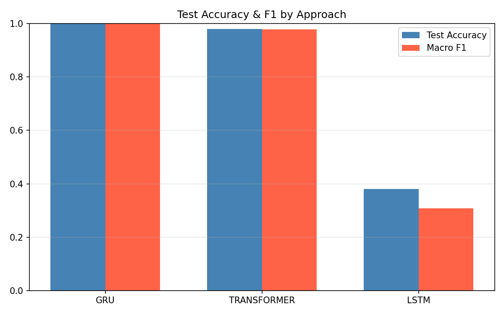
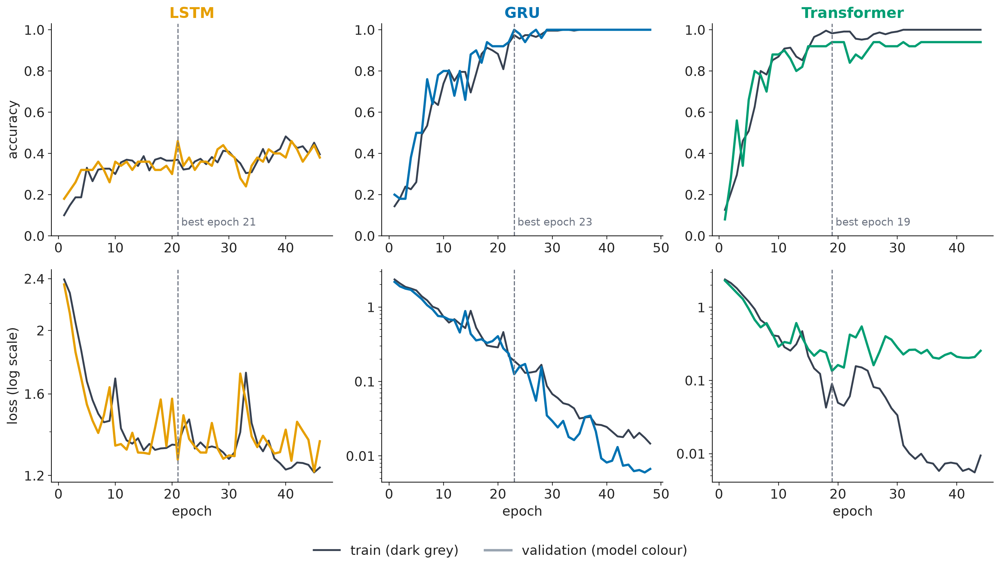
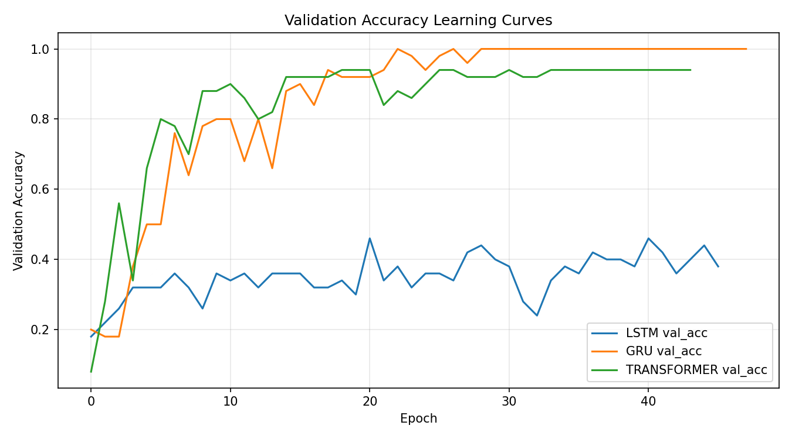

# Khmer Sign Language Word Recognition System

**Author:** _[Your Name Here]_
**Course:** Deep Learning — Final Project

A real-time Cambodian Sign Language (ភាសាសញ្ញាខ្មែរ) word recognition system built with Python, MediaPipe, and three from-scratch PyTorch sequence models (LSTM, GRU, Transformer encoder).

---

## 1. Problem Statement

- **Task:** Given a 90-frame sequence of MediaPipe Holistic body/hand landmarks captured from a webcam, classify which Khmer sign-language word was performed.
- **Input → Output:** `(90 frames × 258 landmark values)` → one of *N* word classes.
- **Problem type:** Multi-class sequence classification (time series).
- **Why it matters:** Khmer Sign Language has very little digital/dataset support compared to ASL or other major sign languages. 

## 2. Dataset

- **Source:** Self-collected via `src/collect_data.py` — each student/contributor performs each sign in front of a webcam.
- **Collection method:** MediaPipe Holistic extracts 258 landmark values per frame (33 pose points × 4 + 21 left-hand points × 3 + 21 right-hand points × 3). Each clip is 90 frames (~3 seconds at 30fps).
- **Size:** `NUM_SEQUENCES` clips × `len(WORDS)` classes (defaults: 30 clips × 11 words = 330 sequences; see `src/collect_data.py` for the exact numbers used in this run — update this section with your real totals after collection).
- **Classes:** how_are_you, again, correct, incorrect, don't_understand, understand, deaf_person, hearing_person, delicious, sorry, thank_you (editable in `WORDS` in `collect_data.py`).
- **Known limitations:** small sample count per class, single signer, consistent lighting/background — the model has not been validated for signer-independent generalization.
- **Split:** fixed 70% train / 15% validation / 15% test, stratified by class, seed 42 (`src/preprocess.py`). The exact split sizes are recorded in `results/split_info.json` after running it. The identical split and test-time preprocessing (MediaPipe landmark extraction, no additional augmentation) are used for every approach.
- **Submitted dataset:** the compiled landmark arrays (`data/X.npy` — 330 clips × 90 frames × 258 values, float32, about 29 MB — plus `data/y.npy` and `data/labels.npy`) are committed directly in this repo under `data/`. The train/val/test split files (`X_train.npy`, `X_val.npy`, `X_test.npy`, `y_train.npy`, `y_val.npy`, `y_test.npy`) are NOT committed; run `src/preprocess.py` to regenerate them (fixed seed, so the split is identical every time; sizes are in `results/split_info.json`). The raw per-clip recordings under `data/<word>/<clip>/landmarks.npy` are also NOT committed (regenerate them with `collect_data.py`); they're intermediate scratch that `extract_landmarks.py` compiles into `X.npy`.

## 3. Approaches Compared

All three are implemented in **PyTorch**, trained **from scratch** on the identical `(90, 258)` landmark sequences and the identical train/val/test split — they differ only in architecture (dimension A from the assignment brief):

| # | Approach | Architecture | File |
|---|----------|--------------|------|
| 1 | LSTM | Stacked LSTM(64→128→64) → Dense(64) → Dense(num_classes) | [`src/models/lstm_model.py`](src/models/lstm_model.py) |
| 2 | GRU | Stacked GRU(64→128→64) → Dense(64) → Dense(num_classes) | [`src/models/gru_model.py`](src/models/gru_model.py) |
| 3 | Transformer | Linear projection → sinusoidal positional encoding → 2-layer self-attention encoder → mean-pool → Dense(64) → Dense(num_classes) | [`src/models/transformer_model.py`](src/models/transformer_model.py) |

## 4. Results Summary

All three approaches were trained from scratch on the identical 230/50/50 train/val/test split (11 classes, 30 clips each) and evaluated on the same held-out 50-clip test set. Full table at [`results/comparison_table.md`](results/comparison_table.md).

| approach    | test_accuracy | precision_macro | recall_macro | f1_macro | trainable_params | training_time_s | epochs_run | device   |
|-------------|---------------|------------------|---------------|----------|-------------------|------------------|------------|----------|
| **GRU**     | **1.00**      | 1.000            | 1.000         | 1.000    | 178,827           | 5.8              | 48         | Tesla T4 |
| Transformer | 0.98          | 0.985            | 0.977         | 0.979    | 307,083           | 8.1              | 44         | Tesla T4 |
| LSTM        | 0.38          | 0.279            | 0.409         | 0.309    | 236,811           | 6.7              | 46         | Tesla T4 |

**GRU is the best-performing approach**, with zero test-set errors. Transformer is close behind with 1 error out of 50. The plain stacked LSTM failed to learn the task under its default settings (see Error Analysis below) — this is itself a meaningful comparison result, not a bug.

**Comparison figures**

Test accuracy and macro-F1 per approach (`results/figures/accuracy_comparison.png`):



Training vs validation curves for every approach (`slides/figures/fig_curves_train_val.png`):



Overlaid validation-accuracy curves (`results/figures/learning_curves.png`):



Per-approach details (training curves, confusion matrix, misclassified examples) are saved under `results/<approach>/`.

## 5. Hyperparameter Tuning

A learning-rate × weight-decay grid search (3 learning rates × 2 weight-decay values, 6 combinations, 60 epochs each, selected on **validation** accuracy, never the test set) was run for GRU (the best approach) and additionally for LSTM, to check whether its poor score was a settings problem rather than a capacity problem. Full results: [`results/gru/hparam_search.json`](results/gru/hparam_search.json), [`results/lstm/hparam_search.json`](results/lstm/hparam_search.json).

| Model | Best combo | Best val_acc | Notes |
|---|---|---|---|
| GRU | `lr=1e-3, weight_decay=0` | 1.00 | 4 of 6 combinations reached 100% val accuracy; weight decay made negligible difference. `lr=1e-4` was too slow (82–86%). This is the combo already used for the reported GRU result above — no retraining needed. |
| LSTM | `lr=1e-4, weight_decay=1e-4` | 0.70 | A lower learning rate than the default (`1e-3`) recovers most of the LSTM's missing performance (48% → 70% val accuracy), confirming the default learning rate was too high for this architecture on 90-frame sequences. The reported LSTM test result above still uses the default `lr=1e-3` (38% test accuracy) to keep the three-way comparison one consistent setting; the tuning result shows the gap narrows substantially with better settings but GRU/Transformer still win decisively.

## 6. Error Analysis

- **GRU: 0/50 test errors.** No misclassifications to analyze.
- **Transformer: 1/50 test errors.** The one mistake was `understand` predicted as `dont_understand` (confidence 0.95). Plausibly a visually similar pair, but the data does not show why; confirm by watching the two clips before claiming a cause.
- **LSTM: 31/50 test errors (62%).** See [`results/lstm/errors.csv`](results/lstm/errors.csv). 24 of the 31 wrong answers were `understand`, each given at confidence ≈0.18 (chance is 1/11 ≈ 0.09, so the model was close to guessing). All 24 came from the five other one-handed signs (`deaf_person`, `delicious`, `dont_understand`, `how_are_you`, `incorrect`). The other 7 errors were `correct`, `again` and `hearing_person` confused with each other. `sorry`, `thank_you` and `understand` were all recognised (recall 100%). So the LSTM picked up a coarse cue (which hands are present) but not the finer differences within each group.
  - **Diagnosis: underfitting.** Its training accuracy ended at only ≈40%, so it failed to fit the training data (it did not memorise it). A no-order baseline reaches 100% on the same data (Section 6.1), so the task is not hard: the LSTM's optimisation failed under these settings.
  - **Possible contributing factor (not proven):** the learning rate. In the tuning search (Section 5), lowering it from 1e-3 to 1e-4 raised the LSTM's validation accuracy from 48% to 70%. Other candidates (default weight initialisation, 90 recurrent steps with only 230 training clips) were not tested.

### 6.1 Sanity checks (`src/diagnostics.py` → `results/diagnostics.json`)

| Check (test set, 50 clips) | GRU | Transformer | LSTM |
|---|---|---|---|
| Test accuracy | 100% | 98% | 38% |
| 95% confidence interval | 93–100% | 90–100% | 26–52% |
| Frames randomly shuffled (mean of 20) | 94% | 93% | 35% |
| Time order reversed | 94% | 88% | 28% |

Non-deep baselines on the same split (not counted as approaches): logistic regression on only the two "hand detected" fractions: **50%**; logistic regression on the per-clip **average** of all 258 values (no time order at all): **100%**.

- Shuffling the frames costs GRU and Transformer only 5–6 points, and a model with no notion of order scores 100%. On this dataset the signs are mostly separable by hand shape and position, so these results do **not** show that the models learned movement over time.
- With 50 test clips one error is 2 points, and the GRU and Transformer intervals overlap almost completely, so "GRU beats Transformer" is not statistically established. GRU/Transformer beating LSTM is (their intervals do not overlap).

## 7. Project Structure

```
KhmerSignLanguage/
├── dataset/                  ← Raw video clips (optional, unused by the current pipeline)
├── data/                     ← Landmark .npy files
│   ├── hello/0/landmarks.npy         (raw per-clip recordings — gitignored, regenerate locally)
│   ├── X.npy / y.npy / labels.npy    (compiled dataset — committed)
│   └── X_train/X_val/X_test.npy, y_train/y_val/y_test.npy  (fixed split — gitignored, run preprocess.py)
├── models/                   ← Saved trained model weights (*.pt — committed; link externally instead if any exceeds 50MB)
├── results/                  ← Metrics, figures, comparison table, per-approach subfolders
│   ├── lstm/  gru/  transformer/    (history.json, meta.json, metrics.json, plots, errors.csv)
│   ├── comparison_table.csv / .md
│   └── figures/
├── notebooks/
│   └── train_colab.ipynb     ← Trains/evaluates all 3 approaches on a free Colab GPU
├── src/
│   ├── landmarks.py          ← Shared MediaPipe feature-extraction (258-d vector)
│   ├── utils.py              ← Seeding, device selection, checkpointing, param counting
│   ├── dataset.py            ← PyTorch Dataset wrapper
│   ├── models/               ← lstm_model.py, gru_model.py, transformer_model.py
│   ├── webcam_test.py        ← Stage 1: Test webcam
│   ├── mediapipe_test.py     ← Stage 1: Test MediaPipe
│   ├── collect_data.py       ← Stage 2: Record training data
│   ├── extract_landmarks.py  ← Stage 2: Compile dataset (X.npy / y.npy / labels.npy)
│   ├── preprocess.py         ← Stage 3: Fixed train/val/test split
│   ├── train.py              ← Stage 4: Train one approach (--model lstm|gru|transformer)
│   ├── evaluate.py           ← Stage 5: Evaluate one approach on the test set
│   ├── hyperparam_search.py  ← Learning-rate / weight-decay search for the best approach
│   ├── compare.py            ← Stage 6: Aggregate all approaches into one table + figures
│   ├── diagnostics.py        ← Sanity checks: frame-shuffle test, no-order baselines, confidence intervals
│   ├── make_slide_figures.py ← Builds the presentation figures in slides/figures/ from saved results
│   ├── make_slide_art.py     ← Draws the non-data slide visuals (slides/art/, Canva-ready PNG + SVG)
│   ├── make_deck.py          ← Builds slides/khmer_sign_language_presentation.pptx from results/ (needs python-pptx)
│   └── predict.py            ← Stage 7: Real-time prediction (webcam)
├── app/
│   └── app.py                ← Stage 8: Streamlit web interface
├── slides/                   ← Presentation deck (PDF/PPTX)
├── requirements.txt
└── README.md
```

## 8. How to Install and Run

### Training on Google Colab (GPU)
See [`notebooks/train_colab.ipynb`](notebooks/train_colab.ipynb) — mirrors Steps 5–9 above with a free T4 GPU. Upload `data/X.npy`, `y.npy`, `labels.npy` and the `src/` folder to Google Drive first.

## 9. Reproducibility

- Random seeds are fixed across Python, NumPy, and PyTorch (`utils.set_seed(42)`), used identically in `preprocess.py`, `train.py`, and `hyperparam_search.py`.
- Every training run checkpoints the best model (by validation accuracy) via `torch.save`/`torch.load` to guard against Colab disconnects (`results/<model>/checkpoint.pt` holds model + optimizer state + epoch; `models/<model>_khmer_sign.pt` holds the final weights used at inference time).
- All three approaches are trained and evaluated on the exact same `data/X_train.npy` / `X_val.npy` / `X_test.npy` split produced once by `preprocess.py`.

## 10. Citations / Reused Code

- [MediaPipe Holistic Landmarker](https://ai.google.dev/edge/mediapipe/solutions/vision/holistic_landmarker) — Google, used for pose/hand landmark extraction (Apache 2.0).
- PyTorch (`torch.nn.LSTM`, `torch.nn.GRU`, `torch.nn.TransformerEncoder`) — model layers are standard library modules; the architectures assembled around them are original to this project.
- No pre-trained classification weights are used — all three approaches are trained from scratch.

## 11. AI Use Disclosure

- **Tools used:** Claude (Anthropic).
- **Scope of use:** Drafting the PyTorch model/training/evaluation pipeline (`src/models/`, `src/train.py`, `src/evaluate.py`, `src/compare.py`, `src/hyperparam_search.py`), converting the original Keras prototype to PyTorch, writing the Colab notebook, and drafting this README.
- **Verification:** All code was reviewed and run locally; results, analysis, and the final written discussion (Sections 4, and the slide deck's discussion/error-analysis/limitations sections) represent my own understanding and interpretation of the outputs.

## 12. Khmer Signs in this Project

_TODO: fill in the Khmer phonetic and script columns — ask your lecturer or a Khmer Sign Language reference, since this needs to be accurate rather than guessed._

| English | Khmer Phonetic | Khmer Script |
|---------|-----------------|--------------|
| how are you |  |  |
| again |  |  |
| correct / right |  |  |
| incorrect / wrong |  |  |
| don't understand |  |  |
| understand |  |  |
| deaf person |  |  |
| person who can hear |  |  |
| delicious |  |  |
| sorry |  |  |
| thank you |  |  |
|        |        |          |

## 13. Limitations & Future Work

**Limitations:**
- **Single signer, single session.** All 330 clips (every train/val/test example) come from one person recording in one room in one sitting. The 100% GRU / 98% Transformer test accuracy almost certainly overstates how well the model would generalize to a different signer, different lighting, or a different camera — the test clips are very similar in style to the training clips. This has not been validated with a second signer.
- **Small dataset.** 30 clips per class (≈21 after the train split) is enough to show a clear comparison between architectures, but is small by deep-learning standards; results from such a small test set (50 clips total) can shift noticeably with new data.
- **No data augmentation.** Only the raw landmark sequences were used; augmenting (time-warping, mirroring, small coordinate jitter) was not attempted and could improve robustness.
- **The dataset is easy.** A logistic regression on clip averages scores 100% and shuffling frames barely hurts GRU/Transformer (Section 6.1), so the comparison cannot show whether the models use temporal information. Signs that differ only in movement, or more than one signer, would be a harder and more informative test.
- **No landmark normalisation.** Coordinates are raw MediaPipe positions in the frame (not relative to the shoulders or scaled by body size), and a missing hand is stored as zeros. The model can therefore pick up signer position and detection dropouts as shortcuts.
- **LSTM was not retrained with its tuned settings.** The reported LSTM row uses the default learning rate. Section 5's search raised its validation accuracy from 48% to 70% at a lower learning rate; its test score at those settings was not measured.
- **Hand-only fallback.** Several signs were performed one-handed, and MediaPipe occasionally failed to detect a hand in a frame (saved as zeros) — most visibly for `sorry` (79% hand-detection rate) and `thank_you` (69%), the two weakest-detected signs in the raw data, though this did not noticeably hurt their final test accuracy here.

**Future work:**
- Record the same 11 signs from at least one additional signer to test cross-signer generalization, which is the most important next validation step.
- Expand the vocabulary beyond 11 words and collect more clips per word (e.g. 60 instead of 30) to make the train/val/test split less fragile.
- Try augmentation (temporal jitter, horizontal flip with left/right hand swap) to see if it closes the LSTM's remaining gap or further stabilizes GRU/Transformer.
- Run a live test with a second person in front of the webcam (`src/predict.py`) as a qualitative check beyond the held-out test set.
